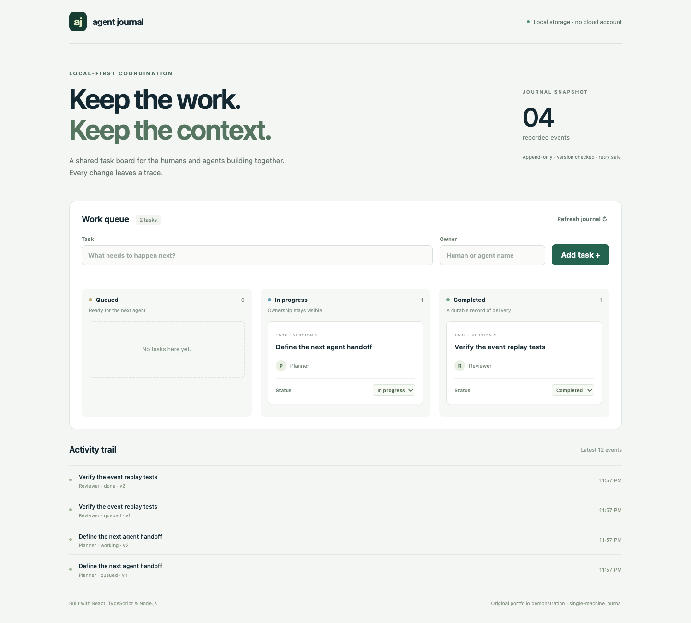

# Agent Work Journal

A small local-first task board for humans and agents, built with **React, TypeScript and Node.js**. An append-only event journal makes ownership and progress inspectable. The server requires no database service, API key or paid subscription.

This is an **original portfolio demonstration**, created for a fullstack engineering application in October 2026. It is not a client deliverable or a claim of prior employment. AI-assisted implementation; the repository is intended to be read, run and reviewed.



## Run it

Requires Node.js **22.12+** and npm.

```sh
npm ci
npm run dev
# Open http://127.0.0.1:5173
```

For the built app:

```sh
npm test
npm run build
npm start
# Open http://127.0.0.1:4310
```

The board starts empty. Add a task with an owner, move it through the three columns, and see the activity trail. Restart the server to confirm that the journal persists in `data/events.jsonl`. Runtime data is ignored by Git. No external fonts, analytics or accounts.

## Design

```text
React UI → JSON HTTP API → validation → serialized command queue
                                         ↓
                             append event + fsync to disk
                                         ↓
                             task projection + activity trail
```

- **Retry safety:** Each command has a request ID. Repeating the same request returns the original event, including after restart. Reusing the ID for a different command returns HTTP 409.
- **Lost-update protection:** Commands include the task's expected version. Only one of two concurrent changes against the same version succeeds. The other returns 409; the UI refreshes the board.
- **Durability:** The server appends a JSONL event and calls `fsync` before acknowledging it. Startup rebuilds tasks from history. An incomplete final line causes startup to fail rather than quietly discarding history.
- **Explicit ownership:** Each task records an owner and version. This app does not execute agents or claim autonomous orchestration.
- **One writer process:** An exclusive lock file prevents starting a second server against the same directory. Within that process, a promise queue serializes commands and snapshots.
- **Bounded requests:** Commands are validated, text fields are limited, and HTTP request bodies are capped at 16 KB. Cross-origin browser writes and non-loopback Host headers are rejected to limit browser cross-site and DNS rebinding attacks.

## API example

```sh
curl -X POST http://127.0.0.1:4310/api/events \
  -H 'Content-Type: application/json' \
  -d '{"requestId":"demo-1","taskId":"handoff-1","expectedVersion":0,"title":"Review handoff","owner":"Planner","status":"queued"}'

curl http://127.0.0.1:4310/api/journal
```

`POST /api/events` accepts the complete desired task state and returns its committed event. `GET /api/journal` returns current tasks and all recorded events. Valid statuses are `queued`, `working`, and `done`. A new task starts with `expectedVersion: 0`; an update supplies its current version. Validation errors return 400, stale versions and conflicting request IDs return 409.

## Verification

`npm test` uses Node's test runner. It exercises 30 simultaneous duplicate commands, competing updates, restart/replay behavior, conflicting request IDs, invalid input, corrupt tail handling and the real HTTP server. `npm run build` runs strict TypeScript checking and compiles the React UI.

## Boundaries and next steps

This is a **single-machine, loopback-only prototype**, not an authenticated multi-user deployment. Another trusted local process can call the API. Do not expose the server publicly. It does not include AI inference, sync, PostgreSQL, pagination or task deletion.

The event log and projection are loaded in memory; this is suitable for a small demo journal. A production version would use transactional storage such as PostgreSQL or SQLite, indexed request IDs, pagination, authentication and monitored backups. Durable storage is only as reliable as the filesystem and disk. After an unclean shutdown, a stale lock may remain; verify the server is no longer running before removing `data/journal.lock`. A damaged journal requires explicit recovery from a backup.

See [architecture notes](docs/architecture.md) for the tradeoffs.

Licensed under the [MIT License](LICENSE).
